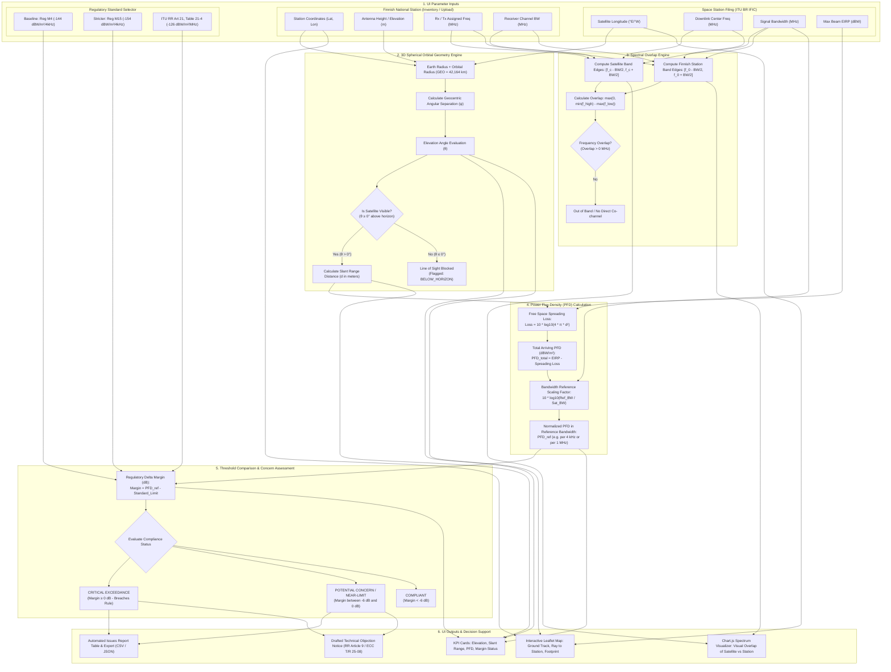
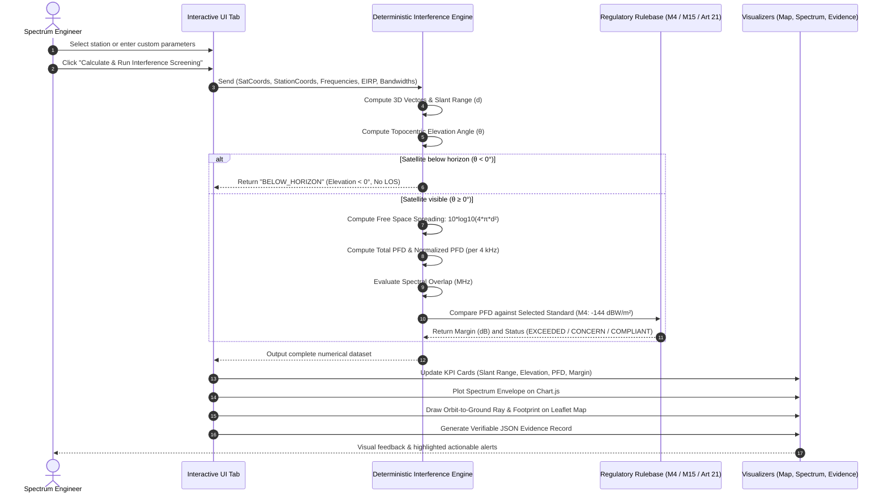

# Traficom Space & Terrestrial RF Interference Screening Engine
## Technical Architecture, UI Element Dataflow & Customer Question Guide

This document breaks down the **Interactive Screening Engine** and its automated sub-systems into visual process flowcharts, mathematical explanations of UI elements, and a targeted questionnaire for Traficom spectrum managers.

---

## 1. End-to-End Processing Flowchart

The diagram below maps every input field in the UI to its internal physics calculation, regulatory evaluation, and final visual outputs.

---

## 2. Element-by-Element Breakdown

| UI Element | Source / Reference | What Happens Internally | Why It Matters to Traficom |
| :--- | :--- | :--- | :--- |
| **Satellite Orbital Longitude** | ITU BR IFIC circulars (e.g. `25.0°E` or `13.0°E`) | Converts satellite orbital position on the equator into 3D ECEF Cartesian coordinates $(X_s, Y_s, Z_s)$ at $R = 42,164\text{ km}$. | Determines whether the satellite is physically above Finland's horizon ($\theta > 0^\circ$). If below, no line-of-sight path exists. |
| **Finnish Station Coordinates & Ground Height** | 874-station Excel dataset (`Asemanro`, `Korkeus`) | Converts WGS84 latitude, longitude, and elevation into 3D station position $(X_t, Y_t, Z_t)$. | Precise ground location dictates elevation angle and geometric distance to the geostationary arc. |
| **Spectral Overlap Calculator** | Downlink frequency & Channel bandwidth vs. Finnish Rx/Tx frequency | Evaluates $[\max(f_{s,\min}, f_{t,\min}), \min(f_{s,\max}, f_{t,\max})]$. If difference $> 0$, an overlap exists. Checks both Rx and Tx per the Traficom rule *"Every TX is received in Finland"*. | Identifies co-channel or overlapping interference where satellite energy enters the receiver passband. |
| **Slant Range ($d$) & Free-Space Spreading** | 3D Euclidean distance vector | Calculates $d = \sqrt{\Delta X^2 + \Delta Y^2 + \Delta Z^2}$ (typically $38,000 - 41,000\text{ km}$ at Finnish latitudes). Spreading attenuation is $10\log_{10}(4\pi d^2) \approx 162.5 - 163.3\text{ dB}$. | Standard inverse-square energy divergence across interplanetary distance. |
| **Power Flux-Density (PFD) Scaling** | Sat EIRP (dBW) & Bandwidth | Arriving $\text{PFD}_{\text{total}} = \text{EIRP} - 10\log_{10}(4\pi d^2)$. Scaled to reference bandwidth ($4\text{ kHz}$ or $1\text{ MHz}$) using $10\log_{10}(\text{BW}_{\text{ref}} / \text{BW}_{\text{sat}})$. | Satellite filings declare peak EIRP across wide carriers (e.g. $20\text{ MHz}$ or $36\text{ MHz}$); limits are normalized per $4\text{ kHz}$ slice. |
| **Regulatory Evaluation Standard** | Dropdown: Regulation M4, M15, ITU RR Art 21 | Margin $\Delta = \text{PFD}_{\text{calc}} - \text{PFD}_{\text{limit}}$. If $\Delta \ge 0\text{ dB}$, flagged **CRITICAL EXCEEDANCE**. If $-6\text{ dB} \le \Delta < 0\text{ dB}$, flagged **POTENTIAL CONCERN / NEAR-LIMIT**. | Automatically highlights filings requiring formal objection within the ITU 4-month regulatory window. |

---

## 3. Sequence Diagram: What Happens When You Click "Run Screening"

---

## 4. Key Questions to Ask the Customer (Traficom Specialists)

Use these targeted questions in interviews or customer alignment sessions:

### A. Regulatory Thresholds & Margins
1. **M4 vs. M15 Baseline:** "We have configured **Regulation M4 ($-144\text{ dBW/m}^2/4\text{kHz}$)** as the default baseline, with **Regulation M15 ($-154\text{ dBW/m}^2$)** selectable for sensitive mobile/terrestrial systems. Are there specific frequency ranges where M15 should be enforced automatically rather than by manual selection?"
2. **Concern Threshold Window:** "Our engine flags any filing within **$6\text{ dB}$ of the limit** as a `POTENTIAL CONCERN` even if it does not strictly exceed the hard limit. Does Traficom prioritize bilateral coordination inquiries for near-limit cases within $3\text{ dB}$, $6\text{ dB}$, or a wider margin?"

### B. Antenna Directivity & Terrain Shielding
3. **Worst-Case Peak Envelope vs. Off-Axis Discrimination:** "Per official advice, we evaluate the worst-case peak beam EIRP envelope because boresight coordinates are often omitted in early IFIC filings. When coordination advances, would you want the tool to ingest ITU-R S.465/S.580 earth station antenna patterns to model off-axis rejection?"
4. **Digital Elevation Models (DEM):** "For terrestrial microwave fixed links, does Traficom require terrain profile obstruction checks (SRTM 30m) along the path, or is geometric line-of-sight sufficient for the initial screening stage?"

### C. Terrestrial Cross-Border (ECC T/R 25-08)
5. **Border Coordination Threshold:** "For the land-mobile side quest, we calculate field strength $E$ along 22 points across the Finnish borders. Is the standard **$30\text{ dB}\mu\text{V/m}$** at 3m antenna height appropriate for all bands, or should we incorporate specific thresholds for 700 MHz (Band 28) and 3.5 GHz (Band n78)?"
6. **Sea vs. Land Propagation Weights:** "Across the Gulf of Finland from Tallinn, ducting and low sea clutter maintain high field strengths over 80 km. Do you prefer ITU-R P.1546 50% time / 50% locations or 10% time (worst-case anomalous propagation) for cross-border coordination?"
